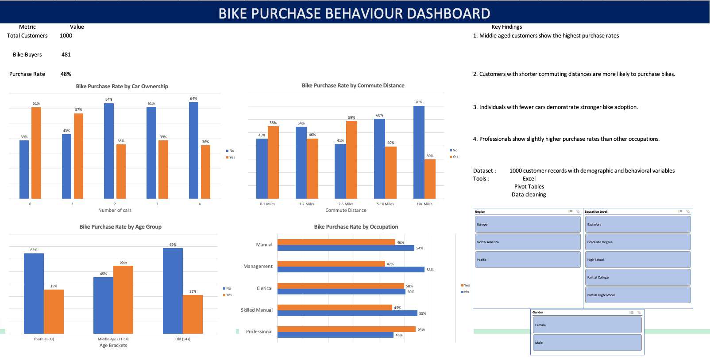

Bike purchase readme · MD
# Bike Purchase Behaviour Analysis
 
**Which customers are most likely to buy a bike, and where should marketing focus?**
 

 
## Objective
Analyse customer demographic data to identify the factors that influence bike purchases.
 
## Dataset
1,000 customer records covering age, income, commute distance, occupation, car ownership, home ownership, region, education and gender.
 
## Tools
Microsoft Excel: data cleaning, pivot tables, pivot charts and slicers.
 
## Approach
1. **Cleaned** the raw data. removed duplicate records, standardised marital status and gender codes, grouped ages into brackets
2. **Analysed** purchase rates with pivot tables by age group, commute distance, car ownership and occupation.
3. **Built** an interactive dashboard with slicers for region, education and gender.
## Key findings
Overall purchase rate: **48%** (481 of 1,000 customers).
 
| Factor | Finding |
|---|---|
| **Age** | Middle-aged customers (31–54) buy at **55%**, compared with 35% for under-30s and 31% for over-54s. |
| **Commute distance** | Purchase rates drop sharply beyond 5 miles: **40%** at 5–10 miles and **30%** at 10+ miles. The 2–5 mile group is highest at **59%**. |
| **Car ownership** | Customers with 0 or 1 car buy at **61%** and **57%**, against 36–39% for households with 2 or more cars. |
| **Occupation** | Professionals have the highest rate at **54%**, slightly ahead of clerical workers (50%). |
 
## Recommendation
Focus marketing on middle-aged customers with commutes under 5 miles and fewer than two cars. That group combines the three strongest purchase signals.
 
## Files
| File | Contents |
|---|---|
| `Bike Sales Customer Analysis.xlsx` | *intro, raw data, working sheet, cleaned data, pivot tables, dashboard.* |
| `dashboard.png` | Dashboard screenshot |
 
GitHub can't preview Excel files. Download the workbook to explore the interactive dashboard and slicers.
